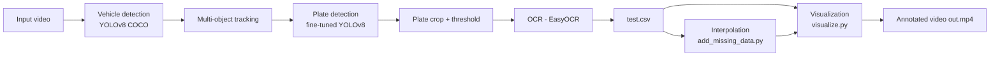

# 🚗 Real-Time License Plate Recognition

License plate detection and recognition on video, built as the license plate module of our graduation project **Real-Time Object Detection for Autonomous Vehicles**.


## 📌 Overview

The pipeline detects vehicles in every frame with a YOLOv8 model pre-trained on COCO, tracks them across frames, localizes license plates with a fine-tuned YOLOv8 detector and reads the plate text with EasyOCR. Per-car results are written to a CSV, optionally interpolated to fill detection gaps, and rendered back onto the video with bounding boxes and the recognized plate numbers.

## 🔄 Pipeline



## 📁 Project Structure

| File | Purpose |
| --- | --- |
| `main.py` | Detection, tracking and OCR pipeline; writes `test.csv` |
| `tracker.py` | IoU-based multi-object tracker |
| `util.py` | CSV writer, plate-format check and OCR helpers |
| `add_missing_data.py` | Interpolates missing bounding boxes between detections |
| `visualize.py` | Draws tracked cars, plates and recognized numbers on the video |
| `test.csv` | Sample output produced on the test video |

## ⚙️ Installation

```bash
pip install -r requirements.txt
```

You also need:

- `yolov8n.pt` — downloaded automatically by Ultralytics on first run.
- `license_plate_detector.pt` - a YOLOv8 model fine-tuned on a license plate dataset. The trained weights are not included in this repository. Place compatible weights in the project root.
- `sample.mp4` — the input video.

## 🚀 Usage

```bash
# 1. Run the pipeline on a video (writes test.csv)
python main.py --video sample.mp4

# 2. (Optional) Fill detection gaps by interpolation
python add_missing_data.py --input test.csv --output test_interpolated.csv

# 3. Render the results on the video (writes out.mp4)
python visualize.py
```

`visualize.py` reads `./test.csv` by default — point it at `test_interpolated.csv` if you ran the interpolation step.

## 📊 Output Format

`test.csv` holds one row per detection:

| Column | Description |
| --- | --- |
| `frame_nmr` | Frame number in the video |
| `car_id` | Persistent track ID of the vehicle |
| `car_bbox` | Vehicle bounding box |
| `license_plate_bbox` / `_score` | Plate bounding box and detector confidence |
| `license_number` / `_score` | Recognized plate text and OCR confidence |

## 🎓 Context

This module is part of the graduation project *Real-Time Object Detection for Autonomous Vehicles*, which combines three fine-tuned YOLO models — cars/pedestrians/cyclists, license plates and traffic lights — deployed with a Gradio interface on Hugging Face.

## 🙏 Credits

- [Ultralytics YOLOv8](https://github.com/ultralytics/ultralytics) — vehicle and license plate detection
- [EasyOCR](https://github.com/JaidedAI/EasyOCR) — license plate text recognition
- Pipeline design follows the *Automatic License Plate Recognition with YOLOv8 and EasyOCR* tutorial by [Computer Vision Engineer](https://www.youtube.com/@ComputerVisionEngineer)
