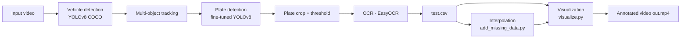

# 🚗 Real-Time License Plate Recognition

License plate detection and recognition on video, built as the license plate module of our graduation project **Real-Time Object Detection for Autonomous Vehicles**.


## 📌 Overview

The pipeline detects vehicles in every frame with a YOLOv8 model pre-trained on COCO, tracks them across frames, localizes license plates with a fine-tuned YOLOv8 detector and reads the plate text with EasyOCR. Per-car results are written to a CSV, optionally interpolated to fill detection gaps, and rendered back onto the video with bounding boxes and the recognized plate numbers.

## 🔄 Pipeline



## 📁 Project Structure

| File | Purpose |
| --- | --- |
| `main.py` | Detection, tracking and OCR pipeline; writes `test.csv` |
| `tracker.py` | IoU-based multi-object tracker |
| `util.py` | CSV writer, plate-format check and OCR helpers |
| `add_missing_data.py` | Interpolates missing bounding boxes between detections |
| `visualize.py` | Draws tracked cars, plates and recognized numbers on the video |
| `test.csv` | Sample output produced on the test video |

## ⚙️ Installation

```bash
pip install -r requirements.txt
```

You also need:

- `yolov8n.pt` — downloaded automatically by Ultralytics on first run.
- `license_plate_detector.pt` - a YOLOv8 model fine-tuned on a license plate dataset. The trained weights are not included in this repository. Place compatible weights in the project root.
- `sample.mp4` — the input video.

## 🚀 Usage

```bash
# 1. Run the pipeline on a video (writes test.csv)
python main.py --video sample.mp4

# 2. (Optional) Fill detection gaps by interpolation
python add_missing_data.py --input test.csv --output test_interpolated.csv

# 3. Render the results on the video (writes out.mp4)
python visualize.py
```

`visualize.py` reads `./test.csv` by default — point it at `test_interpolated.csv` if you ran the interpolation step.

## 📊 Output Format

`test.csv` holds one row per detection:

| Column | Description |
| --- | --- |
| `frame_nmr` | Frame number in the video |
| `car_id` | Persistent track ID of the vehicle |
| `car_bbox` | Vehicle bounding box |
| `license_plate_bbox` / `_score` | Plate bounding box and detector confidence |
| `license_number` / `_score` | Recognized plate text and OCR confidence |

## 🎓 Context

This module is part of the graduation project *Real-Time Object Detection for Autonomous Vehicles*, which combines three fine-tuned YOLO models — cars/pedestrians/cyclists, license plates and traffic lights — deployed with a Gradio interface on Hugging Face.

## 🙏 Credits

- [Ultralytics YOLOv8](https://github.com/ultralytics/ultralytics) — vehicle and license plate detection
- [EasyOCR](https://github.com/JaidedAI/EasyOCR) — license plate text recognition
- Pipeline design follows the *Automatic License Plate Recognition with YOLOv8 and EasyOCR* tutorial by [Computer Vision Engineer](https://www.youtube.com/@ComputerVisionEngineer)

## Training notebook

License plate detection and recognition on video, built as the license plate module of our graduation project **Real-Time Object Detection for Autonomous Vehicles**.


## 📌 Overview

The pipeline detects vehicles in every frame with a YOLOv8 model pre-trained on COCO, tracks them across frames, localizes license plates with a fine-tuned YOLOv8 detector and reads the plate text with EasyOCR. Per-car results are written to a CSV, optionally interpolated to fill detection gaps, and rendered back onto the video with bounding boxes and the recognized plate numbers.

## 🔄 Pipeline


## 📁 Project Structure

| File | Purpose |
| --- | --- |
| `main.py` | Detection, tracking and OCR pipeline; writes `test.csv` |
| `tracker.py` | IoU-based multi-object tracker |
| `util.py` | CSV writer, plate-format check and OCR helpers |
| `add_missing_data.py` | Interpolates missing bounding boxes between detections |
| `visualize.py` | Draws tracked cars, plates and recognized numbers on the video |
| `test.csv` | Sample output produced on the test video |

## ⚙️ Installation

```bash
pip install -r requirements.txt
```

You also need:

- `yolov8n.pt` — downloaded automatically by Ultralytics on first run.
- `license_plate_detector.pt` - a YOLOv8 model fine-tuned on a license plate dataset. The trained weights are not included in this repository. Place compatible weights in the project root.
- `sample.mp4` — the input video.

## 🚀 Usage

```bash
# 1. Run the pipeline on a video (writes test.csv)
python main.py --video sample.mp4

# 2. (Optional) Fill detection gaps by interpolation
python add_missing_data.py --input test.csv --output test_interpolated.csv

# 3. Render the results on the video (writes out.mp4)
python visualize.py
```

`visualize.py` reads `./test.csv` by default — point it at `test_interpolated.csv` if you ran the interpolation step.

## 📊 Output Format

`test.csv` holds one row per detection:

| Column | Description |
| --- | --- |
| `frame_nmr` | Frame number in the video |
| `car_id` | Persistent track ID of the vehicle |
| `car_bbox` | Vehicle bounding box |
| `license_plate_bbox` / `_score` | Plate bounding box and detector confidence |
| `license_number` / `_score` | Recognized plate text and OCR confidence |

## 🎓 Context

This module is part of the graduation project *Real-Time Object Detection for Autonomous Vehicles*, which combines three fine-tuned YOLO models — cars/pedestrians/cyclists, license plates and traffic lights — deployed with a Gradio interface on Hugging Face.

## 🙏 Credits

- [Ultralytics YOLOv8](https://github.com/ultralytics/ultralytics) — vehicle and license plate detection
- [EasyOCR](https://github.com/JaidedAI/EasyOCR) — license plate text recognition
- Pipeline design follows the *Automatic License Plate Recognition with YOLOv8 and EasyOCR* tutorial by [Computer Vision Engineer](https://www.youtube.com/@ComputerVisionEngineer)

## Training notebook

Open `notebooks/train_plate_detector.ipynb` in Google Colab and select a GPU runtime. It fine-tunes YOLOv8n on the CC BY 4.0 license-plate dataset published by keremberke, originally by Augmented Startups. The notebook preserves the original train/validation/test splits, converts COCO boxes to YOLO format, evaluates detection on the test split and exports `license_plate_detector.pt`.

The conversion code was tested on the source three-image validation sample. Full Colab training has not been run during notebook preparation. Free Colab GPU access is not guaranteed. This trains a plate detector, not an OCR model, and does not add Egyptian plate recognition.

Sources and terms:
- Dataset: https://huggingface.co/datasets/keremberke/license-plate-object-detection
- Original dataset: https://universe.roboflow.com/augmented-startups/vehicle-registration-plates-trudk/dataset/1
- Dataset license: https://creativecommons.org/licenses/by/4.0/
- Ultralytics licensing: https://www.ultralytics.com/license

Preserve the dataset attribution and license, and identify format conversion when redistributing derived data. Review the applicable Ultralytics AGPL-3.0 terms before distributing or deploying the model or project. No trained weights or video files are bundled here.

## Pretrained detector demo and limitations

The CPU smoke test used [joker5914/yolov8n-license-plate](https://huggingface.co/joker5914/yolov8n-license-plate), published under **AGPL-3.0**, with its upstream `best.pt` saved locally as `license_plate_detector.pt`. The model author states that it was fine-tuned on the keremberke / Augmented Startups dataset credited above. These are third-party pretrained weights, not a model trained by this project. Preserve the upstream notices and review the [AGPL-3.0 terms](https://www.gnu.org/licenses/agpl-3.0.html). This notice does not relicense third-party material or grant rights beyond its source terms.

For a reproducible source revision, download `best.pt` from model revision `8286762929bd4b111a19186f2a05e0a5940b6088` using Hugging Face's file browser or `hf_hub_download`. Do not load arbitrary untrusted model checkpoints.

The test footage was [Traffic Flow In The Highway](https://www.pexels.com/video/traffic-flow-in-the-highway-2103099/) by **Mike Bird**, used under the [Pexels License](https://www.pexels.com/license/). Download it separately. Test preparation trimmed the first 10 seconds and sampled 3 frames per second; neither source video nor weights are committed here.

```bash
# Prepare the tested excerpt from your separately downloaded source
ffmpeg -i source.mp4 -t 10 -vf fps=3 -an sample.mp4
# This replaces test.csv. Back up the historical included sample first.
python main.py --video sample.mp4 --output demo.csv
# visualize.py reads test.csv, so point it to demo.csv before rendering.
```

On 24 November 2026, the unchanged pipeline ran on that excerpt and produced 25 accepted OCR rows, and the visualizer produced an annotated video. This is a smoke test, not an accuracy benchmark. OCR guesses varied between frames and included errors. The visualizer's crop overlays can overlap. A different 17.83-second London clip produced no accepted OCR text despite plate detections.

The current OCR reader uses English and a seven-character `LLNNLLL` format filter. It does not support Egyptian plates. Detection success alone does not mean the plate text is correct, and no real-time speed or recognition accuracy is claimed.
